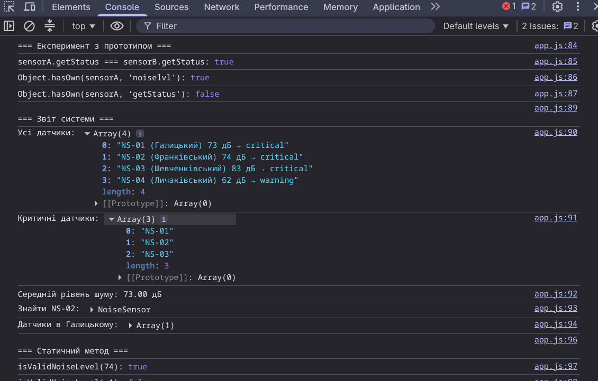
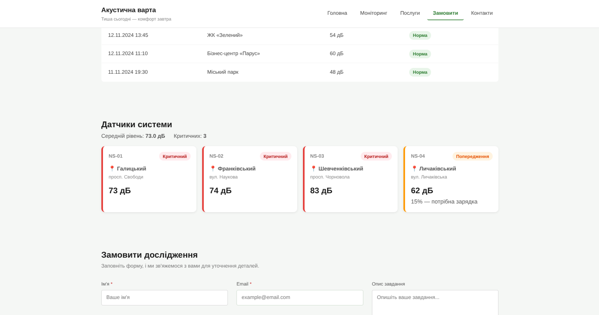

# Звіт до лабораторної роботи №5

## Тема

Проєктування системи класів у JavaScript на прикладі навчального вебпроєкту «Акустична варта».

## Мета роботи

Навчитися переходити від набору окремих об'єктів і функцій до спроєктованої системи взаємопов'язаних класів: виділяти сутності предметної області, визначати їх стан і поведінку, розподіляти відповідальності, будувати композицію, аргументовано використовувати наслідування та інтегрувати об'єктну модель у наявний вебпроєкт.

## Виконання роботи

- рефакторинг JavaScript-частини проєкту: дані сенсорів перетворено з plain objects на екземпляри класів;
- реалізовано клас `NoiseSensor` з конструктором, методами `getStatus()`, `updateNoiseLevel()`, `addMeasurement()` та статичними методами `isValidNoiseLevel()` і `fromObject()`;
- реалізовано клас `NoiseMeasurement` з методами `isValid()` та `toString()`;
- реалізовано клас `MonitoringSystem` з методами `addSensor()`, `findSensorById()`, `getSensorsByArea()`, `getCriticalSensors()` та `getAverageNoiseLevel()`;
- межі класифікації шуму централізовано в об'єкті `NOISE_LIMITS` — числа `55` і `70` не дублюються в коді;
- побудовано композицію `MonitoringSystem → NoiseSensor[] → NoiseMeasurement[]`;
- реалізовано підклас `MobileNoiseSensor extends NoiseSensor` з додатковою властивістю `batteryLevel` та методом `needsCharging()`;
- виконано консольний експеримент з прототипом: перевірено `sensorA.getStatus === sensorB.getStatus`, `Object.hasOwn` для власної властивості та методу;
- JavaScript розділено на файли за відповідальністю: `models/`, `services/`, `app.js`;
- систему інтегровано з вебсторінкою: картки датчиків рендеряться динамічно з CSS-класами `normal`, `warning`, `critical`.

## Структура проєкту

```
laba5/
├── index.html
├── assets/
├── css/
├── scss/
└── js/
├── models/
│ ├── NoiseSensor.js
│ └── NoiseMeasurement.js
├── services/
│ └── MonitoringSystem.js
├── app.js
└── monitoring.js
```

## Результат

Посилання на опублікований проєкт: https://gonflik.github.io/web-something-college/laba5/index.html

Скріншот консолі браузера:





## Висновок

Під час виконання лабораторної роботи реалізовано систему класів для проєкту «Акустична варта». Дані датчиків перетворено з plain objects на екземпляри класу `NoiseSensor`; логіку класифікації шуму централізовано в `NOISE_LIMITS`. Побудовано композицію з трьох рівнів: `MonitoringSystem` містить колекцію `NoiseSensor`, кожен із яких зберігає масив `NoiseMeasurement`. Продемонстровано наслідування через `MobileNoiseSensor extends NoiseSensor` та виконано консольний експеримент із прототипним ланцюжком. Систему інтегровано з вебсторінкою — картки датчиків рендеряться динамічно за даними екземплярів класів.