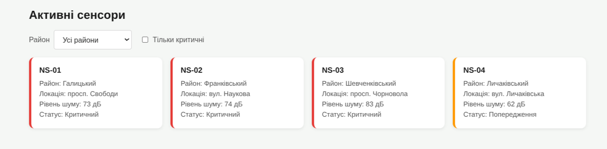
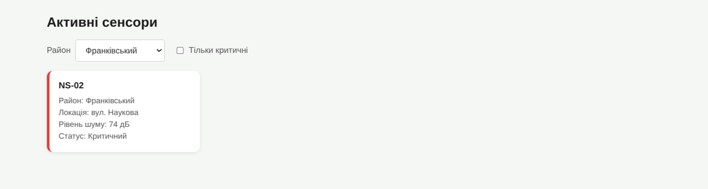
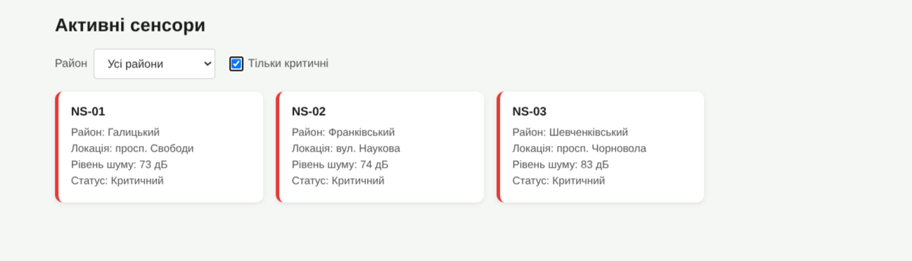

# Звіт до лабораторної роботи №6

## Тема

Відображення та фільтрація сенсорів у DOM на прикладі навчального вебпроєкту «Акустична варта».

## Мета роботи

Навчитися відображати дані сенсорів на існуючій сторінці «Акустична варта» та фільтрувати їх за районом і статусом за допомогою DOM API.

## Виконання роботи

- на сторінку після блоку «Поточний моніторинг» додано нову секцію «Активні сенсори» з фільтром за районом (`select`), чекбоксом «Тільки критичні» та контейнером `.sensor-list`;
- потрібні елементи сторінки знайдено через `querySelector()`;
- реалізовано функцію `createSensorCard(sensor)`, яка створює картку сенсора через `document.createElement()`, наповнює її через `textContent` і збирає через `append()`;
- CSS-клас картки (`sensor-card--normal`, `sensor-card--warning`, `sensor-card--critical`) формується залежно від статусу сенсора;
- реалізовано функцію `renderSensors(sensorArray)`, яка очищує контейнер методом `replaceChildren()` і додає картки для переданих сенсорів;
- реалізовано функцію `applyFilters()`, яка читає вибраний район та стан чекбокса й створює новий масив методом `filter()`;
- обробку фільтрів підключено через `addEventListener("change", applyFilters)` для `select` і `checkbox`;
- замість окремого масиву використано об'єкти `NoiseSensor` та `MobileNoiseSensor` з попередньої роботи (`system.sensors`), тому в коді використано `sensor.area`, `sensor.address`, `sensor.noiselvl` та метод `sensor.getStatus()`;
- у `select` додано район «Личаківський», щоб можна було відфільтрувати мобільний сенсор;
- додано стилі для фільтрів і контейнера карток у `main.css`, картки перевикористовують стилі з лабораторної роботи №5.

## Структура проєкту

```
laba6/
├── index.html
├── assets/
├── css/
├── scss/
└── js/
    ├── models/
    │   ├── NoiseSensor.js
    │   └── NoiseMeasurement.js
    ├── services/
    │   └── MonitoringSystem.js
    ├── app.js
    └── monitoring.js
```

## Результат

Посилання на опублікований проєкт: https://gonflik.github.io/web-something-college/laba6/index.html

Скріншоти:







## Висновок

Під час виконання лабораторної роботи на сторінку «Акустична варта» додано секцію «Активні сенсори», у якій картки сенсорів створюються й додаються в DOM за допомогою JavaScript. Реалізовано фільтрацію за районом і статусом «critical» з використанням методу `filter()` та події `change`; обидва фільтри працюють одночасно, а якщо під умови не підходить жоден сенсор, список залишається порожнім. Оформлення карток змінюється залежно від статусу завдяки додаванню відповідного CSS-класу.