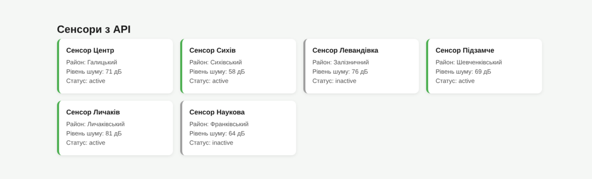
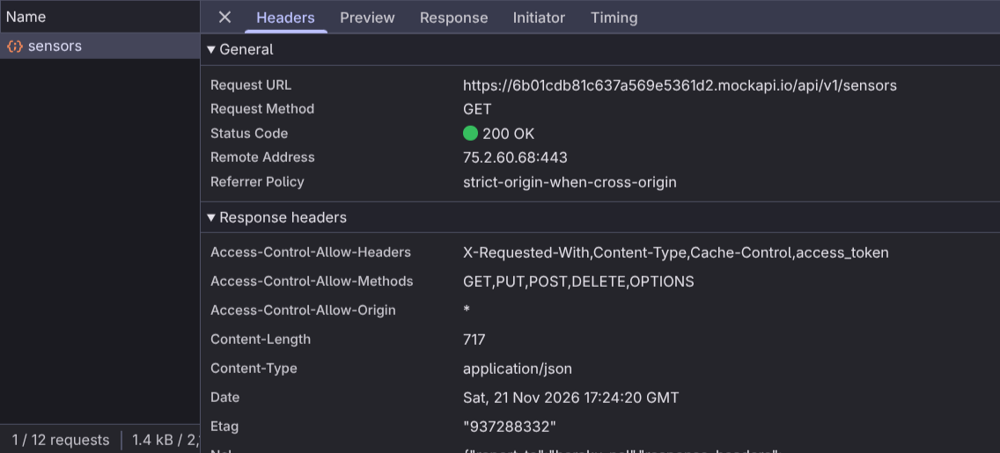
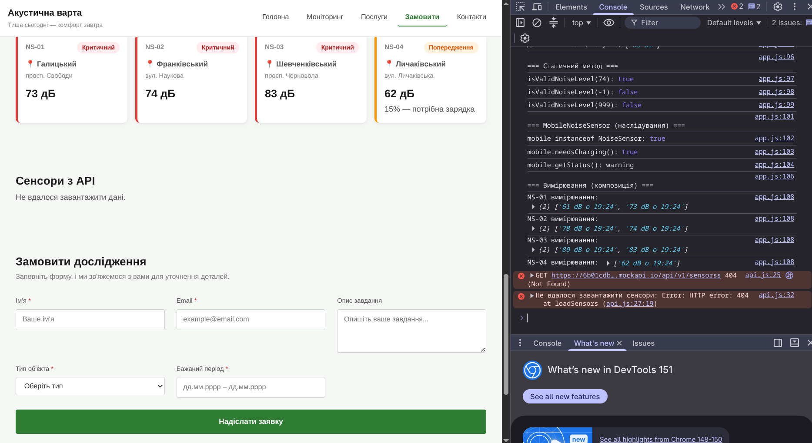

# Звіт до лабораторної роботи №7

## Тема

Завантаження даних з публічного API та відображення на сторінці на прикладі навчального вебпроєкту «Акустична варта».

## Мета роботи

Навчитися отримувати дані з REST API за допомогою `fetch()`, перетворювати JSON-відповідь на масив JavaScript, відображати отримані дані у вигляді карток на сторінці та обробляти просту помилку завантаження.

## Виконання роботи

- у сервісі MockAPI створено проєкт з API prefix `/api/v1` та ресурс `sensors` з полями `name`, `district`, `noiseLevel`, `status`;
- додано 6 тестових сенсорів з різними районами Львова, рівнями шуму та статусами;
- працездатність endpoint `GET /api/v1/sensors` перевірено в адресному рядку браузера до написання JavaScript;
- на сторінку додано секцію «Сенсори з API» з контейнером `#sensors-list`;
- код роботи з API винесено в окремий модуль `js/api.js`, щоб не конфліктувати з функціями з лабораторної роботи №6;
- адресу endpoint збережено в константі `API_URL`;
- реалізовано асинхронну функцію `loadSensors()`, яка виконує GET-запит через `fetch()`, перевіряє `response.ok` та перетворює відповідь на масив методом `response.json()`;
- реалізовано функцію `renderSensors(sensors)`, яка очищує контейнер і створює картку `article` для кожного сенсора; функція не містить `fetch()` і лише відображає передані дані;
- додано обробку помилок через `try/catch`: помилка виводиться в Console, а на сторінці з'являється повідомлення «Не вдалося завантажити дані»;
- обробку помилки перевірено, змінивши `API_URL` на неправильну адресу;
- GET-запит `sensors` зі статусом 200 перевірено у DevTools → Network;
- виявлено й виправлено зайвий символ табуляції в полі `district` одного із записів MockAPI, який робив JSON некоректним;
- картки перевикористовують стилі `.sensor-card` та сітку `.sensor-list` з попередніх лабораторних робіт.

## Структура проєкту

```
laba7/
├── index.html
├── assets/
├── css/
├── scss/
└── js/
    ├── models/
    │   ├── NoiseSensor.js
    │   └── NoiseMeasurement.js
    ├── services/
    │   └── MonitoringSystem.js
    ├── app.js
    ├── api.js
    └── monitoring.js
```

## Результат

Посилання на опублікований проєкт: https://gonflik.github.io/web-something-college/laba7/index.html

Скріншоти:







## Висновок

Під час виконання лабораторної роботи дані сенсорів винесено з JavaScript-коду у тестовий REST API на MockAPI. Сторінка «Акустична варта» отримує їх через `fetch()` за endpoint `/api/v1/sensors`, перевіряє успішність відповіді через `response.ok`, читає JSON методом `response.json()` та передає отриманий масив у функцію `renderSensors()`, яка створює картки сенсорів у DOM. Завантаження та відображення розділено на дві окремі функції. Обробку помилок реалізовано через `try/catch`: при неправильній адресі API користувач бачить повідомлення про помилку, а деталі виводяться в Console. Запит перевірено у DevTools → Network.