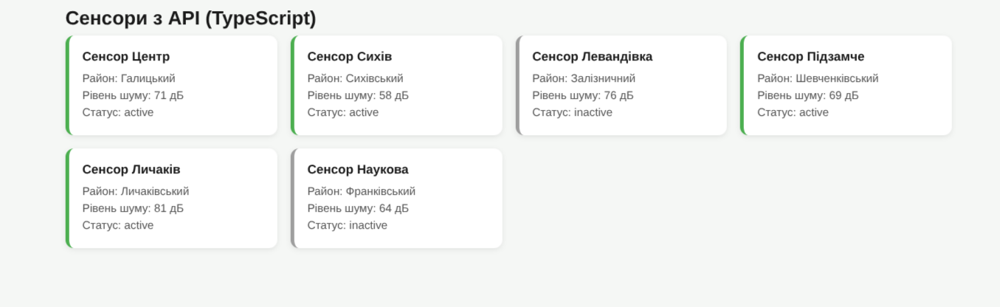
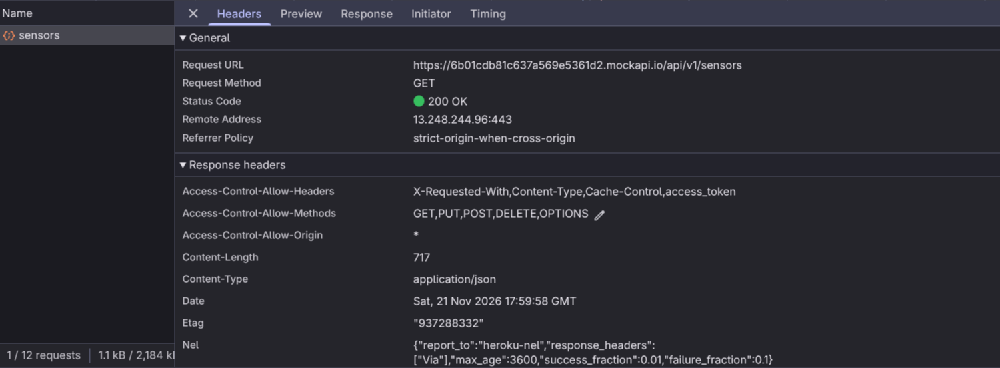
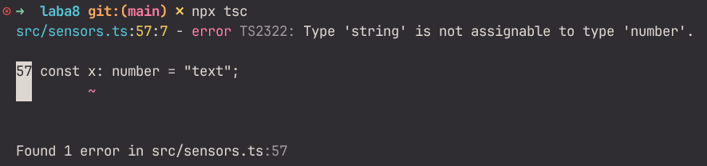
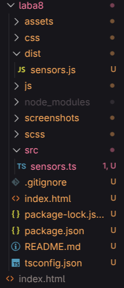

# Звіт до лабораторної роботи №8

## Тема

Робота з даними з API на TypeScript на прикладі навчального вебпроєкту «Акустична варта».

## Мета роботи

Навчитися описувати структуру даних з API за допомогою `interface` у TypeScript, виконувати HTTP-запит до REST API за допомогою `fetch()` з `async/await`, передавати типізований масив `Sensor[]` між функціями та відображати отримані дані на сторінці.

## Виконання роботи

- у проєкт підключено TypeScript: виконано `npm init -y`, `npm install -D typescript`, `npx tsc --init`;
- налаштовано `tsconfig.json` (`target` і `module` — `ES2020`, `strict: true`, `rootDir: ./src`, `outDir: ./dist`);
- використано MockAPI з лабораторної роботи №7 (endpoint `/api/v1/sensors`);
- створено `src/sensors.ts` і описано `interface Sensor` з полями `id`, `name`, `district`, `noiseLevel` та `status` (`"active" | "inactive"`);
- реалізовано асинхронну функцію `loadSensors(): Promise<void>`, яка виконує GET-запит через `fetch()`, перевіряє `response.ok` і записує результат `response.json()` у змінну типу `Sensor[]`;
- реалізовано функцію `renderSensors(sensors: Sensor[]): void`, яка створює картку для кожного сенсора й додає її в контейнер; контейнер отримано через `querySelector<HTMLDivElement>()` з перевіркою на `null`;
- обробку помилок реалізовано через `try/catch`: помилка виводиться в Console, а на сторінці з'являється повідомлення «Не вдалося завантажити дані»;
- картки отримують CSS-клас залежно від статусу (`sensor-card--active` / `sensor-card--inactive`);
- TypeScript скомпільовано командою `npx tsc` у `dist/sensors.js`, який підключено в `index.html` через `<script type="module">`;
- замість `id="sensors"` з методички використано `id="sensors-ts-list"`, оскільки `id="sensors"` вже зайнятий секцією з лабораторної роботи №5;
- підключення `api.js` з лабораторної роботи №7 прибрано, щоб запит не виконувався двічі;
- перевірено роботу типізації: після зміни типу поля `noiseLevel` компілятор показав помилку.

## Структура проєкту

```
laba8/
├── index.html
├── assets/
├── css/
├── src/
│   └── sensors.ts
├── dist/
│   └── sensors.js
├── js/
│   ├── models/
│   │   ├── NoiseSensor.js
│   │   └── NoiseMeasurement.js
│   ├── services/
│   │   └── MonitoringSystem.js
│   └── app.js
├── package.json
└── tsconfig.json
```

## Результат

Посилання на опублікований проєкт: https://gonflik.github.io/web-something-college/laba8/index.html

Скріншоти:









## Висновок

Під час виконання лабораторної роботи завантаження даних з API з лабораторної роботи №7 переписано на TypeScript. Структуру сенсора описано через `interface Sensor`, а масив даних типізовано як `Sensor[]`, що дозволяє компілятору виявляти помилки в назвах і типах полів ще до запуску. Код з `src/sensors.ts` компілюється в `dist/sensors.js`, який підключено до сторінки «Акустична варта». Завантаження (`loadSensors`) і відображення (`renderSensors`) розділено на окремі функції, обробку помилок реалізовано через `try/catch`. Також враховано, що типи TypeScript працюють лише на етапі розробки й не замінюють перевірку даних, які надходять із сервера.