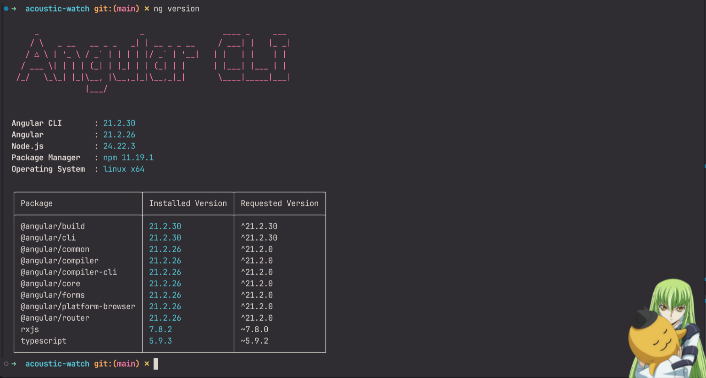
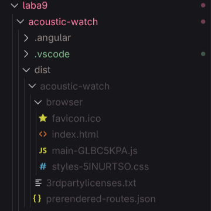
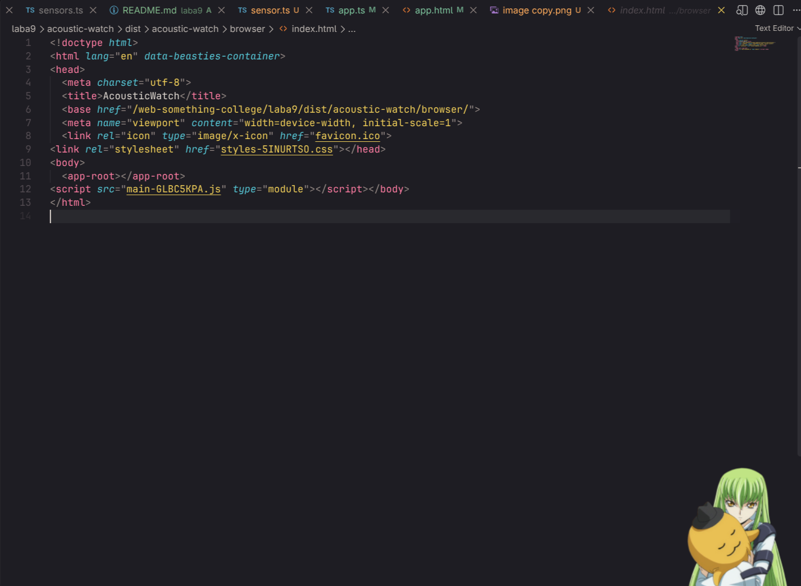
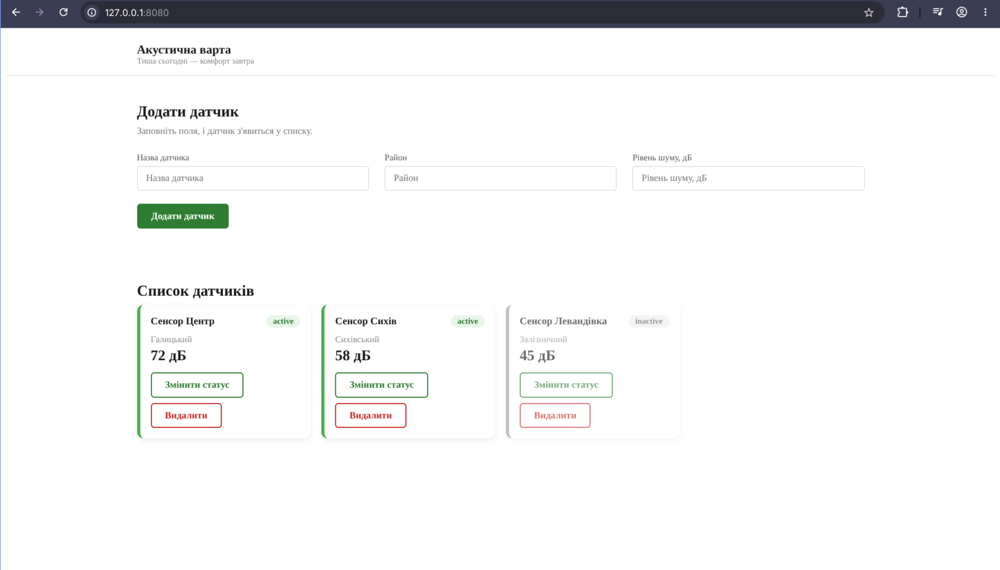
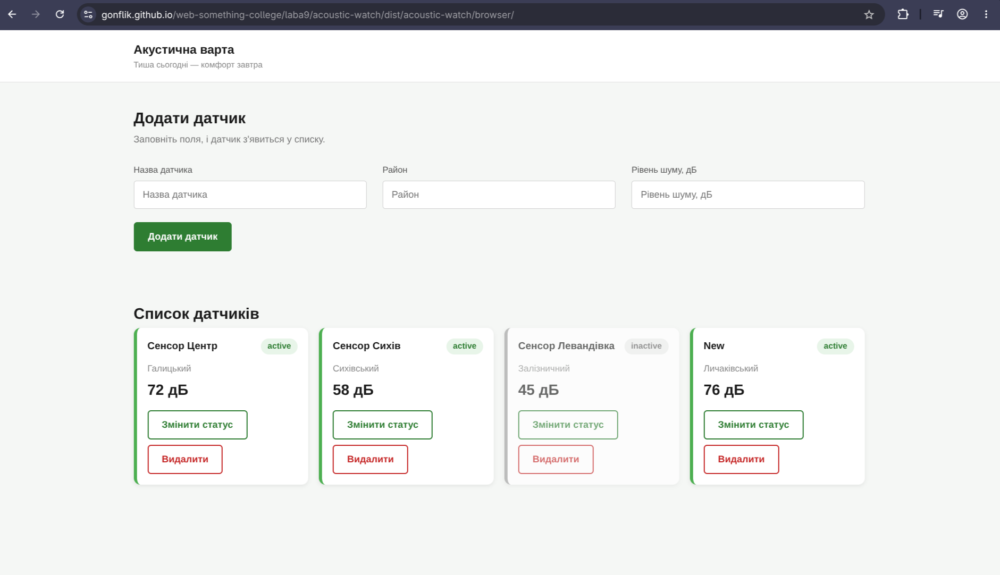

# Звіт до лабораторної роботи №9

## Тема

Створення простого Angular-застосунку («Todo list») на прикладі навчального проєкту «Акустична варта».

## Мета роботи

Навчитися створювати простий Angular-застосунок, працювати з компонентом і шаблоном, відображати список даних, обробляти натискання кнопок, виконувати production build та публікувати готовий застосунок через GitHub Pages.

## Виконання роботи

- встановлено Node.js (підтримувана Angular версія, `v24.22.3`), npm та Angular CLI (`npm install -g @angular/cli`), версії перевірено командою `ng version` (Angular CLI 21.2.30);
- створено проєкт командою `ng new acoustic-watch --routing=false --style=css --skip-tests` (standalone-застосунок без `AppModule`, SSR і SSG);
- проєкт запущено локально через `ng serve`;
- створено модель `Sensor` (`src/app/sensor.ts`) з полями `id`, `name`, `district`, `noiseLevel` та `status` (`'active' | 'inactive'`);
- у `app.ts` створено початковий масив із трьох датчиків та методи `addSensor()`, `deleteSensor()` і `toggleStatus()`;
- для роботи з полями форми підключено `FormsModule` та двостороннє зв'язування `[(ngModel)]`;
- у шаблоні `app.html` список датчиків відображено через `@for ... track sensor.id` із блоком `@empty` для порожнього списку;
- обробку кнопок реалізовано через `(click)`, а оформлення активних і неактивних датчиків — через `[class.sensor-card--active]` та `[class.sensor-card--inactive]`;
- стилі з сайту «Акустична варта» (лабораторні роботи №1–8) перенесено в глобальний `src/styles.css`: шапка, картки з кольоровою смугою, бейдж статусу та форма в стилі «Замовити дослідження»;
- перевірено роботу: перегляд списку, додавання, видалення та перемикання статусу `active` / `inactive`;
- виконано production build командою `ng build`, результат знаходиться в `dist/acoustic-watch/browser`;
- production-версію перевірено через локальний HTTP-сервер `npx http-server dist/acoustic-watch/browser`;
- проєкт без `node_modules` завантажено в репозиторій у папку `laba9` разом із `src` і `dist`;
- для публікації в підпапці GitHub Pages збірку виконано з параметром `--base-href`.

## Структура проєкту

```
laba9/
└── acoustic-watch/
    ├── public/
    ├── src/
    │   ├── app/
    │   │   ├── app.config.ts
    │   │   ├── app.ts
    │   │   ├── app.html
    │   │   ├── app.css
    │   │   └── sensor.ts
    │   ├── index.html
    │   ├── main.ts
    │   └── styles.css
    ├── dist/
    │   └── acoustic-watch/
    │       └── browser/
    │           ├── index.html
    │           ├── main-....js
    │           └── styles-....css
    ├── angular.json
    ├── package.json
    ├── package-lock.json
    └── tsconfig.json
```

## Результат

Посилання на опублікований проєкт: https://gonflik.github.io/web-something-college/laba9/dist/acoustic-watch/browser/

Скріншоти:











## Висновок

Під час виконання лабораторної роботи створено Angular-застосунок для керування списком датчиків міського шуму. Структуру даних описано через `interface Sensor`, список відображено директивою `@for`, а додавання, видалення та зміну статусу датчиків реалізовано методами компонента, які викликаються через `(click)`. Поля форми зв'язано зі змінними компонента через `[(ngModel)]`, а вигляд активних і неактивних датчиків змінюється за допомогою прив'язки CSS-класів. Дані зберігаються тільки в пам'яті застосунку, тому після перезавантаження сторінки список повертається до початкового. Виконано `ng build`, яка створила готові статичні файли в `dist`, їх перевірено через локальний HTTP-сервер і опубліковано на GitHub Pages. Також з'ясовано різницю між `ng serve` для розробки та `ng build` для створення файлів, готових до публікації.